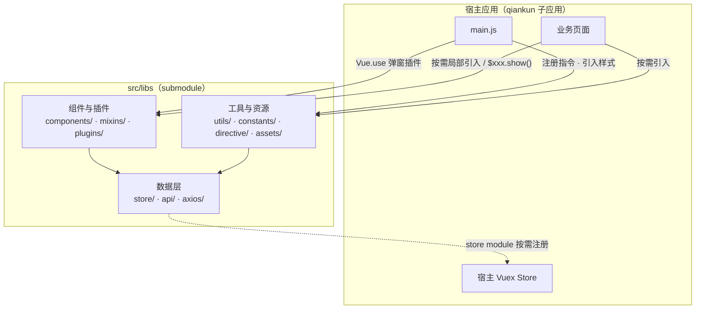

# libs — 公共能力与业务组件库

> git 子模块 [partner-components](http://git-external.leapmotor.com/business-front/webx/partner-components.git)，分支 `develop`。
> 本文档基于 `develop@819dc1f` 整理，**与代码不一致时以代码为准**。

## 架构总览



- **无统一入口**：一律按深路径按需引入（`@/libs/components/Xxx`、`@/libs/utils`），组件在页面内局部注册，不做全局组件注册。
- **libs 不是自包含包**（自身无 package.json），npm 依赖全部由宿主提供：vue、element-ui、axios、qs、lodash、crypto-js、dompurify、xe-utils、vue-print-nb、@leapmotor/splitpanes；vxe-table / element-ui 由宿主 `Vue.use` 全局注册后，libs 组件直接使用标签。

### 接入指南

前提：libs 须位于宿主 `src/` 下（内部互引依赖 `@` alias），npm 依赖全部由宿主提供，element-ui / vxe-table 由宿主 `Vue.use` 全局注册。宿主 main.js 的标准接入：

```js
import '@/libs/directive/index.js';             // 自定义指令引入示例，v-debounce / v-permission / v-safe-html 全局生效
import '@/libs/assets/styles/index.scss';       // 组件样式与 Element UI 覆盖
import '@/libs/assets/iconfont/iconfont.css';
import AuditLogPlugin from '@/libs/plugins/auditLog.js';  // 插件使用示例
import PrintPlugin from '@/libs/plugins/print.js';
import VideoPlugin from '@/libs/plugins/video.js';
import { confirmExport } from '@/libs/utils';   // 方法引入示例

Vue.use(AuditLogPlugin); Vue.use(PrintPlugin); Vue.use(VideoPlugin); // 命令式弹窗 → this.$xxx.show()
Vue.prototype.$confirmExport = confirmExport;
```

业务页面按需注册取用：

| 能力 | 取用方式 |
|---|---|
| 组件 | 局部引入：`import X from '@/libs/components/<目录名>'` |
| mixins | `import x from '@/libs/mixins/<文件>'` |
| utils / constants | `import { x } from '@/libs/utils'` / `from '@/libs/constants'` |
| 命令式弹窗 | 先 `Vue.use(XxxPlugin)` 注册，再 `this.$xxx.show(options)` |
| store module | 在宿主 store 按需注册：`enum`（枚举下拉依赖）、`customView`（接入自定义视图时注册） |
| 请求 | `import api from '@/libs/axios'`（独立实例）或用 `@/libs/api/` 现成封装；运行时依赖 qiankun 注入的 `window.APP_AIS_WEB_CONFIG` |

## 目录结构

```text
src/libs/
├── api/          # 后端接口封装（走 libs axios 实例）：common / attachment / customView
├── assets/       # iconfont、images、styles/（6 个 scss）
├── axios/        # 独立 axios 实例（单文件 index.js）
├── components/   # 38 个业务/通用组件（核心资产，见下文）
├── constants/    # YES_NO_ENUM / TRUE_FALSE_ENUM 及对应 Map
├── directive/    # v-debounce / v-permission / v-safe-html（index.js 汇总，引入即全局注册）
├── mixins/       # 6 个页面混入
├── plugins/      # 4 个 Vue.prototype 插件（命令式弹窗）
├── store/        # 2 个 Vuex module：customView、enum
└── utils/        # 8 个工具模块
```

## 组件 components/

38 个目录，全部局部注册按需引入：`import X from '@/libs/components/<目录名>'`。
分类索引：[附件](#附件)（3）· [页面骨架](#页面骨架)（6）· [表格](#表格)（4）· [弹窗/抽屉](#弹窗抽屉)（9）· [表单输入](#表单输入)（12）· [标签页/其他](#标签页其他)（4）

**旧版**：`page-title/`、`page-search-action/` 已被新版 `AisPageTitle` / `AisPageSearchAction` 取代，勿再使用（新版模板惯用 kebab 标签 `<page-search-action>`）。
**暂无业务用例**（片段为源码推断）：`AisAttachmentList`、`ComponentTable`、`dateranges`、`RemoteSelectWithScroll`、`TextEllipsis`、`BaseTabs`、`MessageDialog`、`auditDialog`。

### 附件

#### AisAttachment — 附件上传/回显核心（按 businessId + 附件配置上传、预览、校验）

```vue
<AisAttachment :businessId="_id" attachType="审计专员1签名" :noEcho="true"
  :uploadConfig="signUploadConfig" @addParam="data => handleUpdate(data, 'auditor1Sign')" />
```

- 配置二选一：`configCode`（后端附件配置）或 `uploadConfig`（前端校验规则：acceptSuffix/maxSize/maxNum/minNum/required）。
- ref 方法：`validate({silent})`、`getFileList()`、`refresh()`；事件：`update` / `ocr-success` / `addParam`。
- `type="card"` 等非 props 属性透传给内部 `AisUpload`（card 为九宫格样式）。

#### AttachmentList — 按 configCode 拉附件配置，分组渲染多个 AisAttachment

```vue
<AttachmentList :business-id="_id" :config-code="configCode" type="card" :readonly="disabled" />
```

- `configCode` 必填；`type`、`title` 等透传给内部 AisAttachment；ref 方法 `refresh()`。

#### AisAttachmentList — 附件分页表格（vxe-table，行内重命名/下载/删除/预览）（暂无业务用例）

```vue
<AisAttachmentList :businessId="businessId" attachType="xxx" :readonly="true" />
```

- 支持 `businessIdList`（优先于 businessId）、`showPagination`；事件 `delete-success` / `download` / `preview`。

### 页面骨架

#### AisPageTitle — 全局页头：面包屑+返回+CustomView 触发器+pre 环境提示，layout 全局挂载

```vue
<!-- 在应用 layout 中挂载一次，业务页不直接使用 -->
<pageTitle />
```

- 无 props，数据全来自 Vuex：`$store.state.menu.activeBreadcrumb`；`$route.meta.customViewBizKey` / `customViewResourceTag` 控制 CustomView 显示。

#### page-title — 旧版纯面包屑，已被 AisPageTitle 取代，勿再使用

#### AisPageSearchAction — 查询表单操作区（查询/重置 + 展开收起）

```vue
<page-search-action v-model="show" is-expandable :loading="loading" @submit="onSubmit" @reset="onReset" />
```

- props：`isExpandable`（默认 true）、`Loading`（注意大写 L）、`align="right"`；事件 `submit` / `reset`。

#### page-search-action — 旧版（查询/清空，mini 尺寸），已被 AisPageSearchAction 取代，勿再使用

#### EditBaseContainer — 编辑/详情页容器：详情加载、表单校验、保存/取消、脏数据确认

```vue
<edit-base-container ref="containerRef" :id="_id" :title="title"
  :isEditing.sync="isEditing" :form.sync="form" :originalForm.sync="originalForm"
  :submitRequest="submitRequest" :detailRequest="detailRequest">
  <template #extraButtons>...</template>
</edit-base-container>
```

- 有 `id` 渲染编辑态头部，无 `id` 渲染新建态底部按钮；插槽 `#status` / `#extraButtons` / `#footer`，默认插槽放 el-form；事件 `validate-fail` / `submit`。

#### EditPageLayout — 编辑页左右分栏布局（@leapmotor/splitpanes），右侧面板可开合

```vue
<edit-page-layout ref="editLayout" :title="pannelTitle" :width="40">
  <template #left><edit-base-container ... /></template>
</edit-page-layout>
<!-- 开合：this.$refs.editLayout.openPane() / closePane() -->
```

- `width` 为右侧面板初始宽度百分比；`showPaneFooter` 显示内置保存/取消（emit `save`/`cancel`），可用 `#footer` 插槽覆盖。

### 表格

#### EditTable — vxe-table 行内编辑表格（列配置编辑渲染器、下拉 options、auth 按钮显隐）

```vue
<edit-table ref="editTable" :columns="columns" :data="tableData" :options="options"
  :auth="{ edit: canAddOrUpdate, delete: canAddOrUpdate }" :enableSingleRowSave="true"
  @save-row-edit="saveRowEdit" @remove-row="handleRemoveRow" />
```

- columns 关键项：`editable`、`editRender{name,props,multiRow}`、`formatter`、`rules`、`defaultValue`、`drag`。
- 分页页码 prop 是 `currentPage`（写 `:current` 无效）；事件 `add-row` / `remove-row` / `save-all` / `value-change` / `checkbox-change` 等；ref 方法 `getData` / `setData` / `validate` / `clearValidate`。

#### expandTable — EditTable 同源变体：编辑配置写死，独有 `dynamicButtons`（外置按钮）与 `dragSort`（首列拖拽排序）

```vue
<expand-table ref="expandTable" :columns="columns" :data="tableData"
  :auth="{ add: false, edit: false, delete: true }" :delTitle="'确认删除该门店吗？'" />
```

#### ComponentTable — 通用分页只读表格（apiMethod 后端分页 / tableDataExternal 前端分页双模式）（暂无业务用例）

```vue
<ComponentTable :columns="columns" :apiMethod="queryApi" :extraParams="{ orderCode }" />
```

- ref 方法 `refresh()` / `getSelection()` / `clearSelection()`；注意与其他业务代码中的同名 `ComponentTable` 区分，import 以 `@/libs/components/` 路径为准；`lazy` 逻辑硬编码依赖 `retailOrderCode`，通用场景慎用。

#### dialogs/SimpleTableDialog — 1200px 大表格弹壳（纯容器，default 插槽放 vxe-table）

```vue
<simple-table-dialog :visible.sync="dialogVisible" :title="'VIN：' + vin" @close="handleClose">
  <vxe-table ... />
</simple-table-dialog>
```

- 从 `@/libs/components/dialogs` 统一导出；内置样式：单元格可换行、弹窗高度撑满视口。

### 弹窗/抽屉

#### AuditLog — 审核日志弹窗（自动拉取、按 changedFields 拆行合并单元格），经插件调用

```js
this.$auditLog.show({ id: row.id }); // 用前 Vue.use(AuditLogPlugin)
```

#### Print — 打印弹窗（vue-print-nb），经插件调用

```js
this.$print.show({ id: this._id, template: 'ReturnOrder', title: '打印回运单', width: 1122 });
```

- `template` 对应宿主 `@/components/PrintTemplate/<template>.vue`（动态 import）；`data` 可选（透传给模板），其余 rest 参数 v-bind 给模板组件；模板不存在自动 toast 并关闭。

#### AisVideo — 视频播放弹窗，经插件调用

```js
this.$video.show({ url: file.url, title: file.name }); // 用前 Vue.use(VideoPlugin)
```

#### UserDialog — 用户信息弹窗，经插件调用（用前先 `Vue.use(UserDialogPlugin)`）

```js
// 用前需先 Vue.use(UserDialogPlugin)
this.$userDialog.show({ userId });
```

#### MessageDialog — 通用确认弹窗（info/warning/danger/success 四态，open() 运行时覆盖文案）（暂无业务用例）

```vue
<MessageDialog ref="msgDialog" type="warning" title="删除确认" description="删除后不可恢复，是否继续？" show-cancel @confirm="doDelete" />
<!-- 打开：this.$refs.msgDialog.open({ type: 'danger', confirmText: '删除' }) -->
```

#### UploadDialog — Excel 导入弹窗（下载模板 + 通用导入，失败行自动下载错误 Excel）

```vue
<Upload :visible="uploadDialogVisible" :id="'1'" @close="handleUploadDialogClose" @getData="getData" />
```

- import 惯用名 `Upload`（组件 name 是 `UploadModal`）；`visible` 非 .sync，靠 `@close` 回调；`id` 为模板配置 id；`async` 开启异步导入；`uploadUrl` 可定制导入接口。

#### VehicleModelDialog — 车型维护弹窗（车系→车型→年款联动，回显已选、重复组合置灰）

```vue
<VehicleModelDialog :visible.sync="modelDialogVisible" :initialData="tableData" @confirm="handleUpdateTableData" />
```

- `confirm` 回调行含 vehicleSeriesId/Name、vehicleModelId/Name、vehicleYearTypeId、vehicleYearType/Name。

#### auditDialog — 审批弹窗（通过/驳回 + 意见输入，驳回时意见必填），详见 [components/auditDialog/README.md](components/auditDialog/README.md)

```js
this.$refs.auditDialog.auditDataList = [currentRow];
this.$refs.auditDialog.show();
// @audit 回调：{ result: 1|0, remark, auditDataList }
```

- 自带 README 未覆盖：还有 `maxlength`（默认 500）prop 与 `close` 事件；目录名小写 `auditDialog`。

#### LogisticsDrawer — 物流轨迹抽屉（el-timeline + 回单凭证预览）

```vue
<LogisticsDrawer ref="logisticsDrawerRef" :visible.sync="logisticsDrawerVisible"
  :drawerData="{ logisticsProvider, logisticsOrderNo }" />
```

- `drawerData` 需含 `logisticsOrderNo` + `logisticsProvider`，变化即请求轨迹；依赖宿主提供的 `@/api/common#getLogistics`（引宿主代码而非 libs/api，libs 脱离宿主单独使用会挂）。

### 表单输入

#### FetchSelect — 四种数据源下拉：静态 options / request 请求 / enumCode 枚举 / remote 远程搜索，自带反显兜底

```vue
<fetch-select v-model="editingOldPartKey" filterable clearable remote
  :remote-method="partRemote" :params="row.oldPartName" :format="formatPartOptions"
  value-key="partAndSupplierId" label-key="displayLabel"
  @change="(value, option) => onOldPartCodeChange(row, value, option)" />
<!-- 枚举模式：<fetch-select enumCode="StatusEnum" v-model="form.statusList" /> -->
```

- `@change` 签名 `(val, selectedOption)`（第二参是完整选项对象）；`params` deep watch 变化自动重载；enumCode 依赖宿主 store 的 `enum` 模块。

#### BaseSearch — FetchSelect 的「搜索框皮肤」：左侧搜索 icon + 右侧「添加」后缀，attrs 全透传

```vue
<base-search v-model="part" filterable clearable remote :remote-method="partRemote"
  value-key="id" label-key="displayText" placeholder="请输入备件编码/名称" />
```

#### TreeSearch — 树形下拉搜索（BaseSearch + isTree），其余参数同 FetchSelect

```vue
<tree-search v-model="ccc" filterable remote :remote-method="cccRemote"
  :treeProps="{ props: { children: 'children', label: 'name' } }"
  :treeListeners="{ 'node-click': handleNodeClick }" label-key="name" value-key="id" />
```

- 非叶子节点通常置 `disabled: true`。

#### RemoteSelectWithScroll — 下拉滚动到底自动按页加载的远程搜索（每页默认 100 条）（暂无业务用例）

```vue
<remote-select-with-scroll v-model="form.companyId" :remote-method="fetchCompanyPage"
  value-key="id" label-key="name" />
<!-- remoteMethod(query, pageNum, pageSize) 需返回 { records, total, totalPage } -->
```

- 同页多实例的滚动监听可能互相干扰；`refresh()` 手动重载。

#### BaseInput — el-input 薄封装，统一 maxLength（普通 100 / textarea 500），attrs 透传

```vue
<base-input v-model="form.activityCode" placeholder="请输入" clearable />
```

#### InputLink — 主题色下划线只读输入框，点击整块新窗口打开 link

```vue
<InputLink v-model="form.dealerName" readonly
  :link="`/service/datacenter/store/store/detail?storeCode=${form.dealerCode}`" />
```

#### TagInput — 批量标签输入框（单条回车添加 / popover 多行粘贴，按换行拆分去重），用于单号/VIN 批量查询

```vue
<tag-input v-model="form.claimTraceCodes" placeholder="请输入" />
```

#### dateranges — datetimerange 选择器，内置 16 个快捷项（本周/本月/最近N天…）+ 跨度限制（暂无业务用例，遗留）

```vue
<date-range-picker v-model="createTime" :limtNum="12" :setDefault="true" deftTime="本周"
  @changeNewTime="value => changeNewTime(value, 'createTime')" />
```

- 组件 name 是 `DatePicker`，与目录名、示例标签三者不一致；ref 方法 `clearTime()`。

#### LPCopy — 内容后显示复制图标，点击复制并提示成功

```vue
<LPCopy :value="form.vin" />  <!-- 默认插槽可自定义展示内容 -->
```

#### LPEncrypted — 密文/明文切换展示（点眼睛调 decryptMethod 解密），受控组件

```vue
<LPEncrypted :value="vin" :decryptMethod="() => decryptField('vin')" @update:value="v => (vin = v)" />
```

- 父级必须监听 `@update:value` 回写；value 变化自动重置回密文态。

#### list-select — 传 `listUrl` 即用的远程搜索下拉（内部 jsonPost），支持级联 params、双行展示

```vue
<list-select v-model="form.modelIds" listUrl="/datacenter/web/materials/vehicleModel/list"
  query-key="modelNameLike" value-key="id" multiple filterable clearable />
```

- `params` 变化会清空已选值并重查；编辑页回写必须加 `v-if="form.id"`；`@change` 签名 `(val, selectedItem)`（仅单选）。

#### TextEllipsis — 单/多行文本超出省略，hover 且确实溢出时显示 tooltip 全文（业务页暂无用例，CustomView 内部在用）

```vue
<TextEllipsis :lines="2" :content="row.remark" />
```

### 标签页/其他

#### EnhancedTabs — 标签页：loadData 远程初始化、搜索添加 tab、add/remove 走 defer 异步回执

```vue
<enhanced-tabs ref="tabs" type="rect" v-model="partId" :load-params="loadParams" :load-data="loadData"
  :item-config="{ valueKey: 'id', labelKey: 'repairItemName', labelFormat: '${repairItemName}(${repairItemCode})' }"
  :remote-method="repairRemote" close-tip="确定删除该项目零件吗？" @remove="onRemove" @add="onTabAdd" />
```

- `@add(newItem, defer)` / `@remove(item, index, defer)`：`defer.resolve()` 成功 / `defer.reject()` 回滚；ref 方法 `refresh()` / `updateLayout()`。

#### BaseTabs — 基础标签页：normal/menu/rect 三型、溢出折叠「更多」、关闭确认、add-popover 插槽（业务页暂无用例，EnhancedTabs 内部在用）

```vue
<base-tabs :items="items" :value="selectedTab" closeTip="确定删除吗？" @change="onChange" @close="onClose" @add="onAdd" />
```

#### ButtonGroup — 按钮组按容器宽度自动折叠进「更多」下拉，点击下拉项触发原按钮 click

```vue
<ButtonGroup maxWidth="90%" collapseDirection="left">
  <el-button @click="handleImport">销售导入</el-button>
  <!-- ...更多按钮，放不下的自动进「更多」 -->
</ButtonGroup>
```

#### CustomView — 列表页「自定义查询视图」整套（条件树构造、视图保存/置顶/性能测试/执行），触发器内嵌于 AisPageTitle，业务页经 mixin 接入

```js
import customViewMixin from '@/libs/mixins/customView';
export default {
  mixins: [customViewMixin],
  methods: {
    async getData () {
      if (this.fetchByCustomView()) return; // 视图锁定时走 executeQuery
      /* 原有列表查询 */
    },
    onReset () { this.resetCustomView(); }
  }
};
```

- 接入前提：路由 meta 配 `customViewBizKey` + `customViewResourceTag`，宿主 store 注册 `customView` module；分页默认读写 `this.optionObj`，可用 `_cvPager` / `_cvSetResult` / `customViewListAdapter` 钩子适配；表单锁定由 mixin 自动 toggle `is-preset-locked` class，业务页无需逐字段 disabled。
- 下拉样式**全局只有一套**：触发器文案固定「系统视图」，带「系 / 默」角标、复制、设为默认（组件默认 props 即标准配置，`viewConfig.js` 是同一份出口，不再有路由 meta 开关）；页面级差异只剩 `localApply`（明细表本地生效 vs 列表页走 executeQuery）与 `columns`（弹窗是否合并表格设置）。

## 公共能力

### utils/

按需引入：`import { x } from '@/libs/utils'`（index.js）或 `from '@/libs/utils/<模块>'`。

- `index.js` — 页面级通用函数集：`downloadExcel`（blob 下载+时间戳文件名）、`handleCommonExport`（导出全流程）、`confirmExport`（导出确认弹窗，可挂为 `Vue.prototype.$confirmExport`）、`handleCommonAction`（确认+API+提示）、`handleCommonPrompt`（输入弹窗+API）、`handleBatchStatusChange`（批量启停用+说明校验）、`batchAuditHandler`（批量审核校验确认）、`validateAttachments`（附件必填/数量校验，只收集错误）、`fetchAndFormatData`（取数+label/value 映射）、`formatAmount`（千分位）、`formatNumberInput`（数字输入清洗限位）、`formatDateTime`、`getEndOfDayString`、`debounce`、`shallowEqual`、`getDomStyle` / `getElementZoomValue`（缩放安全取盒模型）、`appPrefix` / `getRouterPath`（路由前缀）、`generateTitleMap`（columns→field:title）
- `clipboard.js` — `copyText` 剪贴板复制（execCommand 兜底）
- `crypto.js` — `paramsFilter` 请求参数过滤；`decrypt` AES-ECB 解密（登录加密接口）
- `file.js` — `isFileType` 按 fileType/扩展名判断 9 类文件类型
- `navigate.js` — 默认导出 `navigate` 跨子应用路由跳转（qiankun 父路由 / 新窗口）
- `time.js` — `getTimeRangeByType`（中文时间段→时间戳范围）、`getTimeRangeByTypeFormat`、`formatDateTime`

### directive/

统一入口 `import '@/libs/directive/index.js'` 引入后，三个指令全局可用：

- `v-debounce` — 事件防抖：`v-debounce:click.500`、`.immediate` 立即执行后防抖
- `v-permission` — 按钮权限：无权限移除元素、`v-permission:disabled` 置禁用；读宿主 store 的 `pageSource`
- `v-safe-html` — DOMPurify 消毒 HTML：`.nl2br` 换行转 `<br>`、`.strict` 严格模式

### mixins/

- `commonMixins.js` — 页面公共逻辑：isEditing 态、面包屑初始化、keep-alive 激活时按约定调 `getData()` 刷新（列表页取数入口必须叫 getData）、日期快捷项、编辑页折叠、`navigateToRoute`
- `customView.js` — 自定义视图列表页接入（`fetchByCustomView` 钩子、bizKey 分桶、表单锁定 class）；文件头有完整设计文档
- `permissions.js` — 页面按钮权限位（canList/canDelete…），自动裁剪表格操作列按钮
- `popconfirmScrollClose.js` — 页面滚动时自动关闭 el-popconfirm
- `responsive.js` — 按屏宽计算查询表单可见项数（1/2/3）
- `routeGuard.js` — 编辑态 beforeRouteLeave 离开确认

### plugins/

统一模式：`Vue.use(XxxPlugin)` 注册后 `this.$xxx.show(options)`（Vue.extend 单例挂 body）。

| 插件 | 用法 |
|---|---|
| `auditLog.js` | `$auditLog.show({ id })` |
| `print.js` | `$print.show({ id, template, title, data, width })` |
| `video.js` | `$video.show({ url, title })` |
| `userDialog.js` | `$userDialog.show({ userId })` |

### store/

- `enum.js` — namespaced `enum`，枚举缓存（SET_ENUM / getEnum / hasEnum）；FetchSelect `enumCode` 模式依赖它
- `customView.js` — namespaced `customView`，按 bizKey 分桶缓存视图选中态（PATCH_VIEW / RESET_VIEW / REFRESH_VIEW），接入自定义视图时在宿主 store 注册

### constants/

`YES_NO_ENUM` / `YES_NO_ENUM_MAP` / `TRUE_FALSE_ENUM` / `TRUE_FALSE_ENUM_MAP`（`constants/index.js`）。

### api/ 与 axios/

接口封装优先使用 libs 自己的 axios 实例（`@/libs/axios`）：

- 前缀路由：按 AIS_PREFIXES 把请求前缀分发到 `VUE_APP_AIS_URL` / `VUE_APP_WORK_ORDER_URL` / `VUE_APP_LEAPX_URL`；`setWebConfig(window.APP_AIS_WEB_CONFIG)` 运行时注入网关配置
- token 注入、610/401 登出、指定接口解密；方法：`post` / `jsonPost` / `postExport` / `get` / `delete` / `deleteJson` / `putFormData` / `put`
- `api/common.js` — 约 50 个公共接口：表格配置、导入导出模板、枚举、用户/门店、车型系列（vehicle* 一批）、省市、物流、备件、登录登出
- `api/attachment/` — 附件上传/删除/列表/配置 CRUD（18 个函数）
- `api/customView/` — customQueryView / customViewField / customViewMain 三类资源 CRUD + executeQuery / pin / perf

### assets/styles/

`index.scss` 总入口（在 main.js 引入）：`variables.scss`（变量，含 `--leap-color-primary` 主题色）、`components.scss` / `pages.scss`（含 customView 表单锁定样式）、`overwrite.scss`（Element UI 覆盖）、`responsive.scss`。

## 维护约定

- 新增/修改组件或公共能力时，同步更新本文档对应条目；删除能力时删除条目。
- 条目格式：一句话职责 + 真实用法片段。
